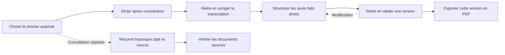
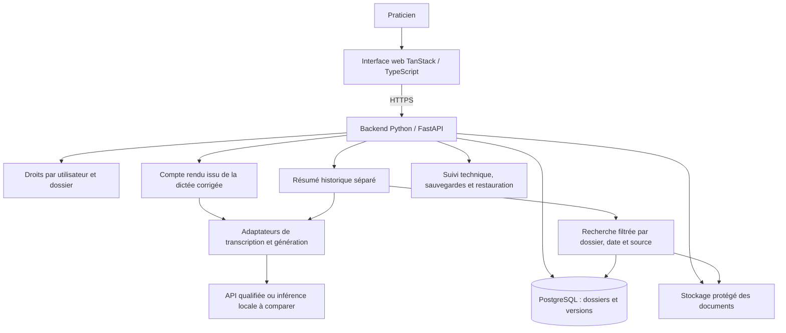

# Cadrage d’un projet IA pour un cabinet médical

**Assistant documentaire · Besoins métier · Architecture cible · Pilotage jusqu’à la décision de mise en production**

Ce dossier propose le cadrage d’un assistant de rédaction pour le cabinet fictif des **Quatre Tilleuls**, composé de quatre praticiens et de deux personnes au secrétariat. L’objectif est de réduire le temps consacré aux comptes rendus tout en conservant la relecture et la validation du médecin.

**Pierre Pluton — Ingénieur IA, responsable du cadrage et du pilotage de la mission proposée.** Le développement est confié à un profil distinct ; les expertises métier, protection des données, sécurité et recette interviennent aux étapes nécessaires.

[Lire le rapport complet — PDF](rapport/rapport-cadrage.pdf) · [Source éditable — Word](rapport/rapport-cadrage.docx) · [Portfolio](https://pierrepluton.com/) · [Compétences](https://pierrepluton.com/competences/)

> **Statut : étude de cadrage pédagogique, version du 25 octobre 2026.** Le contexte, les volumes, les charges et les coûts sont des hypothèses explicites. Les entretiens, le POC, les mesures de performance et la mise en production décrits sont des étapes envisagées, pas des résultats acquis. Ce dépôt documente la mission ; il ne contient pas une application médicale utilisable.

## Lecture du dossier

| Document | Question traitée |
|---|---|
| [Besoins et périmètre](docs/besoins-et-perimetre.md) | Quel problème résoudre, pour qui et dans quelles limites ? |
| [Audit des données](docs/audit-des-donnees.md) | Les données et les outils existants permettent-ils de répondre au besoin ? |
| [Architecture cible](docs/architecture-cible.md) | Quelles briques proposer et quelles alternatives comparer ? |
| [Organisation, budget et planning](docs/organisation-budget-planning.md) | Qui intervient, pour quelle charge et à quel moment ? |
| [Risques et critères de réussite](docs/risques-et-criteres-de-reussite.md) | Quelles preuves demander avant de poursuivre ? |
| [Sources et statut des preuves](docs/sources-et-statut.md) | Sur quelles références et hypothèses repose le cadrage ? |

Le **rapport PDF fait référence**. Les fiches Markdown en facilitent la lecture et reprennent ses choix sans ajouter de résultats expérimentaux.

## Le besoin métier

Le cabinet souhaite faciliter la rédaction après consultation et retrouver rapidement les éléments utiles d’un dossier. Le premier travail consiste à observer son fonctionnement réel : logiciels, formats d’export, temps de recherche, rédaction, correction et validation.

Deux usages sont étudiés séparément :

- **Rédiger un compte rendu** à partir des seuls faits de la dictée corrigée : motif, éléments rapportés, examen et suites dictées.
- **Consulter un résumé de l’historique**, avec dates et sources, pour préparer un suivi. Ce résumé ne complète jamais automatiquement le compte rendu.

Le succès se mesure au **temps net gagné après correction**, à la fidélité des faits et à un coût d’exploitation soutenable. L’ergonomie et la facilité de vérification font partie de la valeur attendue.

## Le parcours proposé

**Hors périmètre initial :** diagnostic, prescription automatique, triage, conseil médical, captation complète de la consultation, portail patient et intégration bidirectionnelle au logiciel du cabinet. Toute modification après validation impose une nouvelle validation avant export.

[Voir le parcours illustré](assets/parcours-utilisateur.png)

## L’architecture cible

| Choix proposé | Justification | Point à confirmer |
|---|---|---|
| TanStack et TypeScript | Parcours interactif de correction, consultation des sources et validation | Ergonomie avec les praticiens |
| Python et FastAPI | Règles métier, autorisations, versions et orchestration IA côté serveur | Contrats d’API et intégrations disponibles |
| PostgreSQL et stockage protégé | Données structurées, provenance et versions | Hébergement, concurrence, sauvegardes et rétention |
| Adaptateurs de modèles | Comparer et remplacer transcription et génération | Qualité, latence, coût et conditions de traitement |
| Recherche documentaire conditionnelle | Aider à retrouver l’historique avec ses sources | Valeur par rapport à une consultation manuelle ou une recherche simple |

Le RAG n’est pas un préalable imposé. Une solution existante ou un gabarit avec dictée simple constituent des alternatives à comparer. Une exécution locale doit aussi intégrer le matériel et la maintenance dans son coût complet.

[Architecture détaillée](docs/architecture-cible.md) · [Schéma du rapport](assets/architecture.png)

## Les responsabilités et les moyens

| Fonction | Jours-personnes | Taux journalier HT — hypothèse | Coût valorisé HT |
|---|---:|---:|---:|
| Ingénieur IA et pilotage — Pierre | 5 | 650 € | 3 250 € |
| Développeur full stack | 8 | 500 € | 4 000 € |
| Médecin référent | 1 | 700 € | 700 € |
| DPO / conseil juridique | 1 | 900 € | 900 € |
| DevOps / sécurité | 0,5 | 750 € | 375 € |
| QA / recette | 1 | 550 € | 550 € |
| **Total travail** | **16,5** | | **9 775 €** |

Le **jour de fonction data engineering est inclus** dans les cinq jours de l’ingénieur IA. Les **deux jours développeur du POC sont inclus** dans les huit jours de développement. Ces fonctions représentent des contributions ponctuelles, pas six recrutements à temps plein.

| Poste | Enveloppe HT |
|---|---:|
| Travail valorisé | 9 775 € |
| Services avant réception | 250 € |
| Sous-total | 10 025 € |
| Réserve de 20 %, après arbitrage | 2 005 € |
| **Budget initial proposé** | **12 030 €** |
| Fonctionnement après réception, distinct du budget initial | **400 €/mois** |

Le fonctionnement comprend 150 € de services techniques et 250 € de maintenance valorisée. **Il s’agit d’hypothèses de cadrage, pas de devis ni de tarifs fournisseur garantis.** Le coût économique sur douze mois d’exploitation serait de 16 830 € HT, avec le budget initial. L’audit et les essais doivent confirmer ou réviser ces montants.

## Le planning et les décisions

**Environ quatre semaines, avec une semaine de réserve S5.** Les 16,5 jours-personnes sont une charge cumulée, pas une durée calendaire. J3, J5 et J6 désignent des jalons, pas des numéros de jours. La revue J3 intervient après le POC et avant d’engager la suite ; les avis externes peuvent décaler le calendrier.

[Répartition par phase et planning détaillé](docs/organisation-budget-planning.md) · [Planning illustré](assets/planning.png)

## Les critères de passage

| Dimension | Cible ou condition proposée |
|---|---|
| Valeur métier | Au moins deux minutes nettes gagnées par compte rendu, correction et vérification comprises |
| Fidélité | Aucun défaut critique observé dans les cas de recette ; au moins 95 % des faits requis couverts |
| Provenance | Sources reliées au bon dossier et datées ; information absente signalée |
| Autorisation | Tous les tests négatifs d’accès, de version et d’export passent |
| Exploitation | Restauration testée, support identifié et procédures de reprise disponibles |
| Passage au réel | Conditions de traitement qualifiées, recette acceptée et décision du sponsor |

Ces cibles restent à approuver avec le cabinet. Un petit jeu de recette ne démontre pas l’absence d’erreur future. Une erreur critique impose de suspendre le parcours concerné, même si les scores moyens sont satisfaisants.

## Ma contribution et la prochaine décision

Ce projet illustre ma manière d’aborder une mission d’ingénierie IA : comprendre le processus métier, évaluer les données, justifier une solution proportionnée et organiser les responsabilités jusqu’à la réception. Je souhaite rendre des traitements complexes accessibles par une interface claire, qui facilite la relecture et laisse la décision au praticien.

La recommandation est de **valider le besoin et l’audit avant d’engager la réalisation**, puis de comparer la solution la plus simple aux alternatives. Le sponsor décide de poursuivre à partir des preuves réunies, des coûts actualisés et des conditions d’usage.

**Auteur :** [Pierre Pluton](https://pierrepluton.com/) · Projet réalisé dans le cadre du parcours AI Engineer OpenClassrooms.
