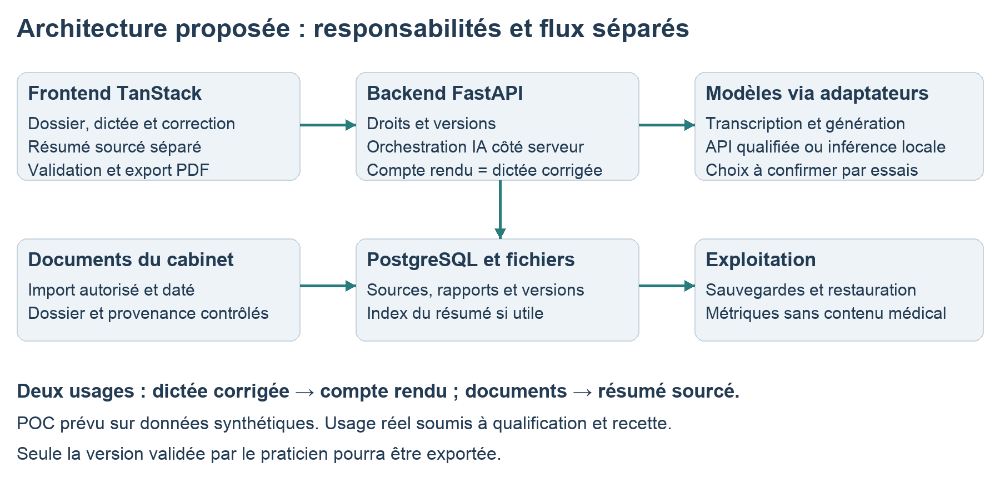

# Architecture cible et alternatives

[Retour au dossier](../README.md) · Référence : rapport, pages 6 et 7.

## Séparation des responsabilités

Le frontend TanStack présente le parcours et les états. Le backend FastAPI porte les autorisations, l’orchestration IA, les règles de version et la validation. Les secrets fournisseur restent côté serveur. PostgreSQL conserve les données structurées et les versions ; les documents sont stockés dans un espace protégé.

Deux traitements restent indépendants : structurer le compte rendu depuis la dictée corrigée et résumer les documents historiques. L’historique ne fournit aucun fait supplémentaire au compte rendu. Une recherche documentaire filtre le dossier autorisé, les dates et les sources avant de fournir un contexte au générateur.

Les documents sont traités comme des données, pas comme des instructions. L’export porte sur une version validée ; toute modification retire cette validité.

## Comparaison des options

1. Gabarit et dictée simple : référence de complexité minimale.
2. Solution existante : vérifier qualité, intégration, export, contrats et devis.
3. Sur mesure sans RAG : parcours adapté, historique consulté manuellement.
4. Sur mesure avec RAG : résumé sourcé dont la valeur doit dépasser l’effort de vérification.

Pondération proposée : valeur métier 30 %, qualité factuelle 25 %, sécurité et conditions d’usage 20 %, coût complet 15 %, simplicité 10 %. Faire approuver les poids ; exclure une option incompatible avec les conditions de traitement avant toute notation. Aucun score fournisseur n’est inventé.

## Modèles et exploitation

Transcription, embeddings éventuels et génération utilisent des adaptateurs remplaçables. Aucun modèle n’est définitivement retenu. Comparer qualité, latence, coût, disponibilité et conditions de traitement sur les mêmes cas.

Une API gérée réduit l’infrastructure à exploiter ; une inférence locale exige matériel, mises à jour et continuité de service. Le local n’est pas automatiquement moins cher ou conforme. SQLite peut servir dans une configuration d’essai limitée ; PostgreSQL reste la cible proposée pour le service partagé.

Les besoins de traitement en arrière-plan, les limites d’usage et les reprises sont dimensionnés après essais, sans imposer une infrastructure distribuée disproportionnée.
