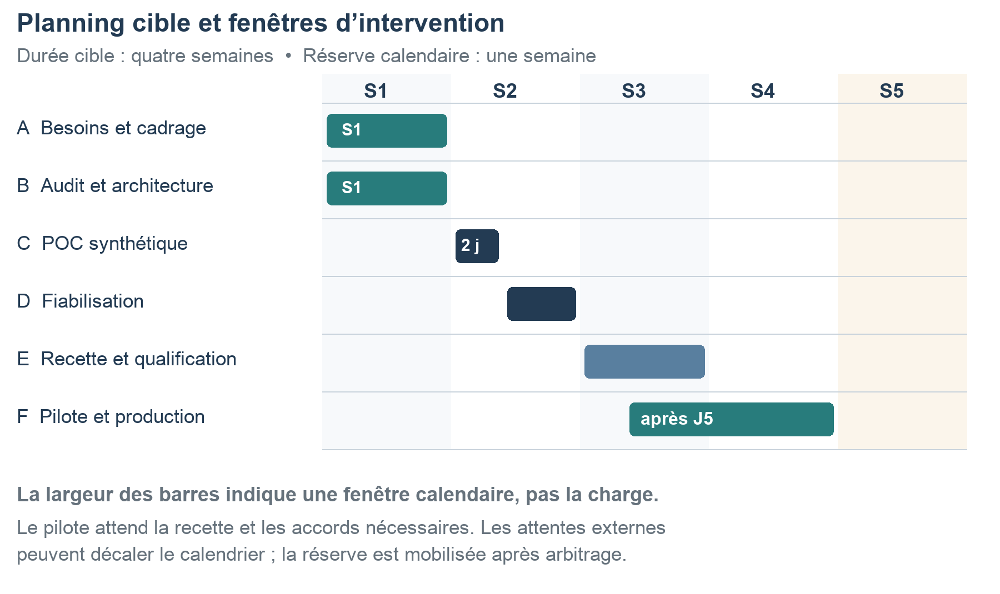

# Organisation, budget et planning

[Retour au dossier](../README.md) · Référence : rapport, pages 8 à 16.

## Répartition de la charge

Pierre définit les besoins, l’audit, l’architecture et le protocole, pilote les coûts/délais et consolide les preuves. Le développeur réalise et corrige. Le médecin accepte la qualité métier ; le QA contre-vérifie les parcours ; les conseils juridique et sécurité donnent leurs avis. Le sponsor décide du financement et des passages de jalon.

| Phase | IA / pilotage | Développeur | Médecin | DPO / conseil | DevOps | QA | Total jours |
|---|---:|---:|---:|---:|---:|---:|---:|
| A Besoins et cadrage | 1 | 0 | 0,25 | 0,5 | 0 | 0 | 1,75 |
| B Audit et architecture | 1,5 | 0,5 | 0 | 0,25 | 0 | 0 | 2,25 |
| C POC synthétique | 0,5 | 2 | 0,25 | 0 | 0 | 0 | 2,75 |
| D Fiabilisation | 0,5 | 3 | 0 | 0 | 0,25 | 0,25 | 4 |
| E Recette et qualification | 1 | 1 | 0,25 | 0,25 | 0,25 | 0,75 | 3,5 |
| F Pilote et production | 0,5 | 1,5 | 0,25 | 0 | 0 | 0 | 2,25 |
| **Total** | 5 | 8 | 1 | 1 | 0,5 | 1 | 16,5 |

Un jour fonctionnel data est intégré aux cinq jours IA. Les deux jours de POC sont compris dans les huit jours développeur. Une journée vaut sept heures. Les contributions internes du sponsor et les retours courts du secrétariat sont à réserver, mais ne sont pas valorisés dans cette première estimation.

## Calendrier conditionnel

- S1 : besoins, audit, architecture et avis initiaux.
- Début S2 : POC sur données synthétiques ; revue J3 pour conserver, simplifier ou arrêter.
- Fin S2 : fiabilisation, selon la décision J3.
- S3 : recette, qualification et décision J5 avant pilote réel.
- S3–S4 : pilote, corrections, transfert et décision J6 de réception.
- S5 : réserve calendaire si nécessaire. Les attentes externes peuvent décaler les fenêtres.

Les contributions sont réparties selon les disponibilités ; 16,5 jours-personnes ne signifie pas 16,5 jours calendaires. Le chemin critique passe par les besoins, les données, le POC, la fiabilisation, la recette et le pilote.

## Budget

Travail valorisé : **9 775 € HT**. Services avant réception : **250 €**. Réserve de 20 % sur 10 025 € : **2 005 €**. Enveloppe initiale : **12 030 € HT**, POC inclus.

Fonctionnement central proposé : 120 €/mois d’infrastructure et sauvegardes, 30 € de modèles et 250 € de maintenance valorisée, soit **400 €/mois**. Budget initial et douze mois de fonctionnement : **16 830 € HT**. Ces montants doivent être confirmés par devis et essais, notamment pour la chaîne d’hébergement qualifiée.

Scénario POC seul : deux jours développeur, une demi-journée IA, un quart de journée médecin et 50 à 100 € de services, soit 1 550 à 1 600 € avant préparation A/B et réserve. Ne pas additionner ce montant au budget global : le POC y figure déjà.

## Valeur économique et arbitrages

Hypothèse : 1 000 rapports mensuels et deux minutes nettes gagnées représentent 33,3 heures libérées. À 60 €/heure de valorisation illustrative, cela représente 2 000 € de capacité, pas une économie de trésorerie garantie. Après 400 € de fonctionnement, le retour simple théorique serait de 7,5 mois à valorisation complète ; à 25 % de valorisation, environ 120 mois.

Décider selon la qualité, le temps net, l’adoption et la soutenabilité. Le sponsor arbitre toute consommation de réserve ; un retard de jalon supérieur à deux jours ouvrés déclenche une alerte. Une migration complexe, un GPU dédié, une procédure de certification ou un support permanent nécessitent un chiffrage distinct.
